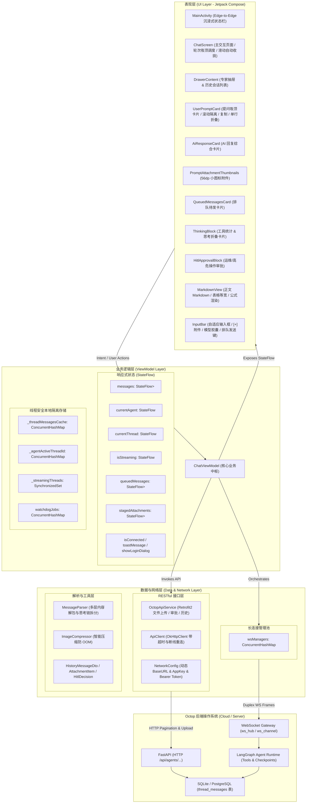

# Octop Android 客户端软件架构详细设计文档 (v1.0.25)

> **文档版本**：v1.0.25  
> **更新时间**：2026-10-16  
> **技术栈**：Kotlin + Jetpack Compose (Material3) + Coroutines/StateFlow + Retrofit2 + OkHttp3 WebSocket + Coil + Markdown-KaTeX  
> **配套版本**：Octop Server v1.0.1+ (LangGraph 智能体引擎)  
> **当前状态**：全面对标 Antigravity Web 移动端交互范式，支持多模态小图标、滚动隔离、流式排队与吸顶置顶

---

## 1. 系统概述与设计目标

### 1.1 系统定位
**Octop Android 客户端**是针对 Octop 私有化多智能体操作系统专门研发的移动端原生应用。应用面向多专家协作、深度思考心智链可视化、大模型工具调用监控以及离线/后台长时间任务的异步交互场景，深度对齐 Google Antigravity Web 端现代化移动交互规范，提供轻巧、高信息密度与极致顺滑的原生操作体验。

### 1.2 核心设计目标
1. **多智能体并发与常驻长连接**：支持多个专业智能体（如育儿管家、家庭医生、运维工程师等）并行执行，切换智能体时不掐断后台长连接，不丢失正在生成的数据。
2. **零泄漏的严格状态隔离**：通过双重路由安全锁（`agentId + threadId`），杜绝跨智能体数据窜门与界面污染。
3. **Antigravity 交互范式对齐**：
   - 交互轮次重组与动态置顶吸顶卡片（Turn Sticky Header）。
   - 全局提问栏智能收拢（单行极简条）与点击非提问区域/滑动时瞬时自动收回。
   - 提问对话框内部纵向滚动与外层列表彻底隔离（Nested Scroll Isolation），滑动绝不连带拉扯后方答案。
   - 大模型思考/生成中排队发消息机制（In-Streaming Message Queue）。
   - 56dp 微边框小图标缩略图展示，彻底告别撑屏大图。
4. **低延迟流式打字与双向容错**：支持 WebSocket 双向流式传输、自动断线指数退避重连、以及多会话独立的看门狗超时监控。
5. **富媒体与专业排版**：原生集成 Markdown 语法渲染、数学公式、代码高亮一键复制、原生深度思考折叠卡片及 HITL 高危工具执行审批。

---

## 2. 整体架构分层 (MVVM + UDF)

应用严格遵循 Google 推荐的 **现代 Android 应用架构规范（Modern Android Architecture）**，采用 **MVVM（Model-View-ViewModel）** 模式，结合 **单向数据流（UDF, Unidirectional Data Flow）** 与响应式状态流（`StateFlow`）：



---

## 3. 核心子系统与关键架构设计

### 3.1 专家级长连接池与后台运行保障 (`wsManagers`)
- **架构方案**：ViewModel 内部维护 `wsManagers = ConcurrentHashMap<String, OctopWebSocketManager>()`；
- 每个智能体首次激活时分配一个专属的长连接实例；
- 切换专家（`selectAgent`）时仅切换 UI 订阅的 StateFlow，**后台专家的 WebSocket 持续保持存活**；
- 实例开启 `pingInterval(15, TimeUnit.SECONDS)` 保活机制，支持连接断开时带有随机扰动的指数退避自动重连。

### 3.2 跨专家双重路由安全锁 (`agentId + threadId`)
- 服务端原始 JSON 帧内部并未附带 `thread_id`，为杜绝串门：
  1. `OctopWebSocketManager` 内部维护私有 `activeThreadId`；
  2. ViewModel 维护 `_agentActiveThreadId: ConcurrentHashMap<agentId, threadId>`；
  3. 所有下行处理函数更新界面前必须通过强校验：
     $$\text{IsVisible} = (\text{\_currentAgent.agentId} == \text{agentId}) \land (\text{\_currentThread.threadId} == \text{targetThreadId})$$
  4. 未满足条件的下行数据静默落盘至该会话的内存缓存 `_threadMessagesCache`，绝不刷新前台界面。

### 3.3 交互轮次重组与吸顶卡片机制 (Turn Sticky Header & Instant Headroom)
- **轮次聚合算法 (`groupMessagesIntoTurns`)**：
  将线性存储的对话列表按用户提问重新聚合成 `ChatTurn(id, userMessage, aiMessages)` 结构。
- **瞬时头部缓冲与平滑收拢 (`Animatable`)**：
  为确保发送消息后能 100% 精确置顶在屏幕最上方，同时杜绝回复结束后可向上拉出黑边大空白的问题：
  ```kotlin
  val bottomSpacerAnimatable = remember { Animatable(16f) }
  LaunchedEffect(isStreaming) {
      if (isStreaming) {
          // 发送瞬间 0 延迟注入 85% 视口缓冲，确保 animateScrollToItem 不会被底部高度钳制
          bottomSpacerAnimatable.snapTo(configuration.screenHeightDp * 0.85f)
      } else {
          // 回复完成后平滑收拢至 16dp 正常底距
          bottomSpacerAnimatable.animateTo(16f, animationSpec = tween(durationMillis = 350))
      }
  }
  ```

### 3.4 提问卡片智能收拢体系 (`activeExpandedTurnId`)
- **全局唯一展开状态**：
  定义 `var activeExpandedTurnId by remember { mutableStateOf<String?>(null) }`，默认所有历史提问处于单行折叠模式（`isCollapsed = activeExpandedTurnId != turn.id`）。
- **三维感知收拢**：
  1. **滑动感知**：`LaunchedEffect(listState.isScrollInProgress)` 触发时立即将 `activeExpandedTurnId` 置空，列表一动提问卡片即自动收拢为单行。
  2. **点击感知**：点击 AI 答复文本、列表背景或底部空白缓冲时，立即收拢提问卡片。
  3. **对称展开**：点击单行折叠条随时重新展开查看全文与小图标，点击“点击收拢”即可收回。

### 3.5 提问对话框内部滚动隔离 (Nested Scroll Isolation)
- **设计痛点**：在长提问卡片内部上下滑动浏览提问时，若滑动到卡片顶端或底端，Compose 会将未消费位移冒泡给外层 `LazyColumn`，导致拉出上一轮历史或把当前答案顶上来（Issue 024）。
- **拦截架构**：
  在 `UserPromptCard` 展开状态挂载专用 `NestedScrollConnection`：
  ```kotlin
  val stopNestedScrollConnection = remember {
      object : NestedScrollConnection {
          override fun onPreScroll(available: Offset, source: NestedScrollSource) = Offset.Zero
          override fun onPostScroll(consumed: Offset, available: Offset, source: NestedScrollSource) = available
          override suspend fun onPreFling(available: Velocity) = Velocity.Zero
          override suspend fun onPostFling(consumed: Velocity, available: Velocity) = available
      }
  }
  ```
  配合顶栏与外层容器的 `.scrollable(Orientation.Vertical)` 捕获，实现提问框手势完全闭环消化，**在提问对话框内任意滑动，外层答案列表纹丝不动**。

### 3.6 生成中排队发消息机制 (In-Streaming Message Queue)
- **机制流程**：
  1. 大模型在回复或思考中，用户依然可以在输入框打字或添加附件；
  2. 发送按钮自动感知状态，切换为 Antigravity 标志性的 **蓝色圆底排队箭头图标**；
  3. 点击发送后，消息进入 `queuedMessages`，在输入框上方呈现半透明毛玻璃排队队列卡片；
  4. 支持在排队卡片上一键撤回删除已排队内容；
  5. 当前轮次流式接收完毕（`onDone`）瞬间，系统自动将队列队首消息出队并无缝发送，开启下一轮对话。

### 3.7 多模态附件管道与 56dp 小图标缩略图
- **管道流程**：
  1. 支持拍照、系统相册多选与文件管理器多选。
  2. 本地采用 `ImageCompressor` 对超大图片做等比缩放与采样压缩（长边限制 2048px，JPEG 82% 质量），防止 OOM。
  3. 待发附件在输入框上方 `AttachmentTray` 中呈现。
  4. 发送后，在 `UserPromptCard` 中废弃 240dp 大图，采用 **56dp × 56dp**、10dp 圆角的微边框小图标缩略图（`PromptAttachmentThumbnails`），支持横向滑动多图与点击调用全屏大图查看器。

---

## 4. 数据模型规范 (Data Schema)

### 4.1 `ChatMessage` (表现层聚合实体)
| 字段名 | 类型 | 说明 |
| :--- | :--- | :--- |
| `id` | `String` | 唯一标识（UUID 或 服务端 Message ID） |
| `isUser` | `Boolean` | 是否为用户发送的消息 |
| `content` | `String` | 最终呈现的正文内容（已剥离思考与原始协议块） |
| `thinking` | `String` | 完整的深度心智链内容（多阶段用 `\n\n---\n\n` 拼接） |
| `isThinkingExpanded` | `Boolean` | 思考卡片当前是否展开 |
| `isStreaming` | `Boolean` | 是否处于流式生成状态中 |
| `toolCount` | `Int` | 整轮调用的工具总次数 |
| `attachments` | `List<AttachmentItem>` | 绑定的附件列表（图片/文件） |
| `hitlPending` | `HitlPendingInfo?` | 人在回路高危操作审批信息 |
| `timestamp` | `Long` | 消息创建毫秒级时间戳 |

### 4.2 `AttachmentItem` (附件模型实体)
| 字段名 | 类型 | 说明 |
| :--- | :--- | :--- |
| `id` | `String` | 附件唯一 ID |
| `localUriString` | `String?` | 本地 Content URI（本地优先预览，防闪烁） |
| `filename` | `String` | 原始文件名 |
| `mimeType` | `String` | 媒体类型（`image/jpeg`, `application/pdf` 等） |
| `size` | `Long` | 文件字节数 |
| `isImage` | `Boolean` | 是否为图像类型 |
| `status` | `AttachmentStatus` | 状态：`PENDING` / `UPLOADING` / `SUCCESS` / `ERROR` |
| `workspacePath` | `String?` | 服务端工作区相对路径 |
| `uploadedAgentId` | `String?` | 绑定的智能体 ID，防止跨工作区串传 |

---

## 5. 构建、版本与发布路径

| 项目 | 配置与路径 |
| :--- | :--- |
| **编译工具链** | JDK 17 (Amazon Corretto 17.0.12), Android SDK 34, Gradle 8.7 |
| **Min SDK / Target SDK** | Min 26 (Android 8.0) / Target 34 (Android 14) |
| **当前软件版本** | **v1.0.25** (`versionCode = 26`) |
| **本地生成路径** | `/Users/konglingling/gemini/octop-v1.0.25.apk` |
| **共享工具盘归档** | `/Volumes/tools/apk/octop-v1.0.25.apk` 与 `octop-v1.0.0.apk` |
| **云端同步分发** | Google Drive `octop-apk/` (`octop-v1.0.25.apk`、`octop-v1.0.0.apk`、`octop-android.zip`) |
| **Git 远程仓库** | `origin main` (`https://github.com/jieiceone/octop-android.git`) |
